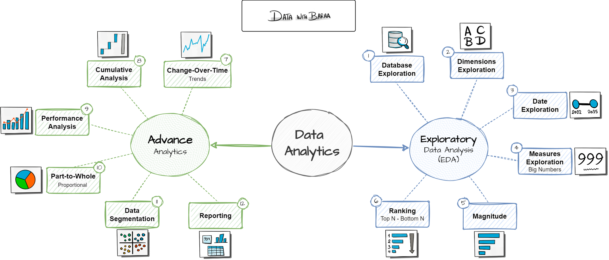

- Análises feitas: 
  - Change over time analysis
  - Cumulative analysis
  - Perfomance analysis
  - Part to whole analysis
  - Data segmentation analysis
  - Reporting
    - Customer aggregation
    - Products aggregation

